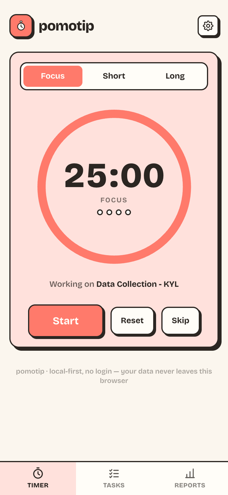

# pomotip



A pomodoro timer that is only living in our browser. No login, no server, no analytics. Tasks and pomodoro history stay on our device, in this browser.

## Why

pomotip started as an iseng-iseng project. I wanted a pomodoro timer that doesn't ask for my email address and doesn't quietly upload my work habits into somebody's database. A kitchen timer doesn't have an account. You wind it, it dings, you wind it again. So I tried to build the browser version of that: open the page, press start, get to work.

## What it does

- Focus, short break and long break. 25, 5 and 15 minutes by default, with a long break after every 4th pomodoro, all adjustable in settings.
- Tasks with pomodoro estimates. Mark one as active and the timer shows what you are working on; finished pomodoros tick up on the task itself.
- Reports with daily, weekly, monthly and annual views, so the history becomes something you can actually look at.
- Installable as a PWA. After the first visit it works offline, the whole app is about 280 kB cached.
- A neubrutalist look, because flat rounded rectangles all look the same to me now.

## Where your data lives, and what can take it away

Everything is stored in this browser's localStorage under the `pomotip:` prefix: settings, tasks, sessions, the active task, even the running timer. There is no backend to talk to. A finished pomodoro writes a few kilobytes of JSON into your own browser and stops there.

About updates, because this is the first question I asked myself: yes, your data survives them. When a new version is deployed, the service worker swaps the cached assets and nothing touches localStorage. The data is tied to the site's address, so it keeps working as long as the app stays on the same domain.

What can actually lose your data, as far as I know:

- Clearing site data, or "cookies and site data" for this site. This is the big one.
- Safari's intelligent tracking prevention deletes script-writable storage after 7 days of not visiting a site. Adding pomotip to the home screen is supposed to sidestep that, but test it yourself before trusting a month of pomodoros to it.
- The browser deciding it needs the disk space back. Rare, but I cannot promise it never happens.

So if the history matters to you, Settings has an export button that hands you a JSON backup, and an import that puts it back. Your whole year of focus is a file smaller than one photo.

## Run it yourself

```bash
npm install
npm run dev      # local dev server
npm run build    # typecheck + production build into dist/
npm run preview  # serve the production build
```

The stack is React 19, Vite, Tailwind CSS 4 and vite-plugin-pwa. There is also a small puppeteer script, `node overflow-check.mjs`, that walks the three views at phone widths and yells if anything overflows horizontally. It expects the preview server on port 4174.

## What is next

I honestly don't know how far this should go. Task reordering seems likely. Sync across devices I keep going back and forth on, because local-first is the point, and the moment a server appears the kitchen timer needs an account. Maybe never. Maybe when it annoys me enough.

If you find a bug, or the design offends you, open an issue. I am happy to be told I am wrong about any of this.
